**UG1101**

# S-A-A-2

## User Guide

**2020/01**

Table of Contents

### Table of Contents

### 1 - Introduction

Credits — 3

Relationship to the NanoVNA — 3

S-A-A-2 Specifications — 4

VNA basics — 5

### 2 - User interface

Main screen — 6

Menu screen — 8

Keypad screen — 9

Device settings — 10

### 3 - Performing measurements

Setting the measurement frequency range — 13

Calibration — 14

Trace display — 15

Markers — 17

Time domain operation — 18

Recall calibration and settings — 22

### 4 - NanoVNA-QT Software

User interface — 24

Connecting to the device — 25

Setting sweep range and parameters — 26

Calibration — 27

Firmware Update — 29

### 5 - Appendix I – Hardware architecture 6 - Appendix II – USB data interface

Protocol description — 32

Host to device command list — 33

Register descriptions — 34

Register descriptions (DFU mode) — 36

# 1 - Introduction

This user guide describes basic usage and operation of the S-A-A-2 (also recognized on the market as NanoVNA V2).

Note: OwOComm does not manufacture or market end user products including the S-A-A-2. The S-A-A-2 is a hardware design with supporting firmware and software designed on contract by OwOComm and released to the public. The specifications and functionality described in this document apply only if the design is faithfully replicated by a manufacturing vendor.

For support please contact your supplier, vendor, or distributor.

For engineering inquiries and project proposals contact [OwOwOwOwO123@outlook.com](mailto:OwOwOwOwO123@outlook.com) (do **not** contact this address for customer support).

## Credits

Portions of this user guide are derived from cho45's "NanoVNA manual".

[https://github.com/cho45/NanoVNA-manual](https://github.com/cho45/NanoVNA-manual)

This user guide is supplied under the terms of the CC BY-NC-SA 3.0 license.

## Relationship to the NanoVNA

The S-A-A-2 hardware is not based on the NanoVNA. For details see Appendix I – Hardware architecture.

The S-A-A-2 firmware is based on ttrftech's NanoVNA firmware. The UI code is kept mostly intact (other than porting to C++11) while the low level infrastructure and signal processing code are rewritten.

The USB interface is similar to the NanoVNA in that it passes commands over a virtual serial port. However, much of the sweep and data transfer logic is reworked in order to support faster sweep rates and avoid data corruption. See Appendix II – USB data interface.

## S-A-A-2 Specifications

| Parameter Frequency range | Specification 50kHz - 3GHz | Conditions - |
| --- | --- | --- |
| System dynamic range | 70dB | f < 1.5GHz, calibrated |

$$60dB f >= 1.5GHz, calibrated$$

S11 noise floor -50dB f < 1.5GHz, calibrated

$$-40dB f >= 1.5GHz, calibrated$$

| Sweep rate | 100 points/s | f >= 140MHz |
| --- | --- | --- |
|  | 80 points/s | f < 140MHz |
| Sweep points (on device) | 10 – 201 points, adjustable | - |
| Sweep points (USB) | 1 – 1024 points, adjustable | - |
| Power supply | USB, 4.6V – 5.5V | - |
| Supply current | 350mA typ, 400mA max | No charging |
| Battery current, charging | 1.2A typ | - |
| Battery capacity | Vendor defined | - |
| Operation ambient | 0℃ - 45℃ * | * by design, not tested in |
| temperature |  | producton |
| Ambient temperature during | 10℃ - 45℃ |  |
| battery charging |  |  |

## VNA basics

A Vector Network Analyzer (VNA) measures the reflection and transmission behavior of a device under test (DUT) across a configured frequency range.

The S-A-A-2 is a two port T/R (transmission/reflection) VNA which can measure the S parameters S11 and S21 of a two port network, or the reflection coefficient (S11) of a one port network.

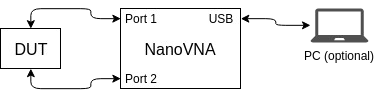

Before any measurements are performed, the VNA must be calibrated. See section 3.1.Calibration for details.

# 2 - User interface

## Main screen

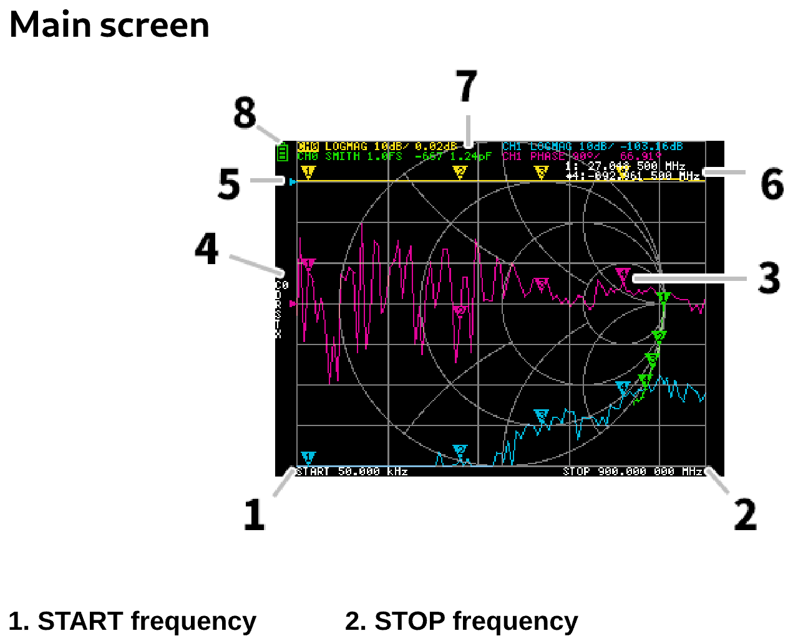

## 1. START frequency 2. STOP frequency

The START frequency and STOP frequency are shown at the bottom of the display.

## 3. Marker

The marker position for each trace is displayed as a small numbered triangle. The selected marker can be moved to any of the measured points in the following ways:

- Drag a marker on the touch panel – best to use a stylus for this.

- Press and hold the JOG LEFT or JOG RIGHT buttons.

## 4. Calibration status

Displays the saved slot number of the calibration being used and the error correction applied.

- C0 C1 C2 C3 C4 : Each indicates that the corresponding calibration data is loaded.

- D : Indicates that port 1 3-term error model is applied.

## 5. Reference position

Indicates the reference position of the corresponding trace. You can change the position with:

**DISPLAY →SCALE →REFERENCE POSITION.**

## 6. Marker status

The active marker that is selected and one marker that was previously active are displayed top right.

## 7. Trace status

The status of each trace format and the value corresponding to the active marker are displayed. For example, if the display is showing: **CH0 LOGMAG 10dB/ 0.02dB** , read it as follows:

Channel CH0 (reflection) Format LOGMAG Scale is 10dB Current value is 0.02dB For active traces, the channel name is highlighted.

## 8. Battery status

This is not shown on the S-A-A-2. Battery percentage is indicated by the 4 red LEDs along the left side on the bottom of the device.

## Menu screen

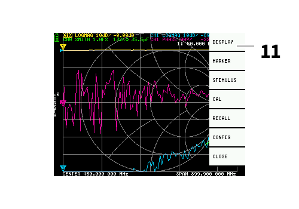

## 11. Menu List

The menu can be opened by the following operations:

- When a location other than a marker on the touch screen is tapped.

- When the ENTER button is pressed.

## Keypad screen

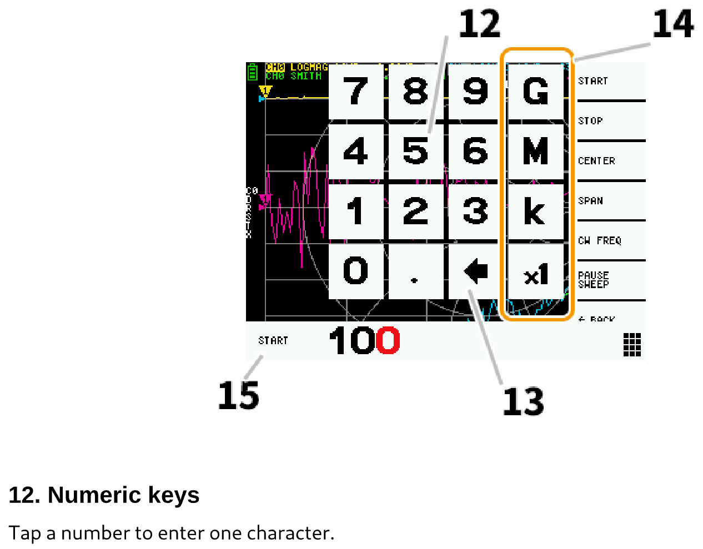

## 13. Back key

Delete one character. If no character is entered, the entry is canceled and the previous state is restored.

## 14. Unit key

Multiplies the current input by the appropriate unit and terminates input immediately. In case of ×

1, the entered value is set as it is.

## 15. Input field

The name of the item to be entered and the entered number are displayed.

## Device settings

The **CONFIG** menu contains general settings for the device:

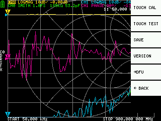

### Saving device settings

Select **CONFIG →SAVE** to save general instrument settings. General device settings are data that includes the following information:

- Touch screen calibration information

- Grid color

- Trace color

The **CONFIG →SAVE** command does not apply to calibration settings.

### Display version info

Select **CONFIG →VERSION** to display device version information.

### Firmware update mode

**CONFIG →DFU** and **ENTER DFU** mode. Select **RESET AND ENTER DFU** to reset the device and

enter DFU (Device Firmware Update) mode. In this mode, firmware can be updated via USB.

DFU mode can also be entered by holding down the "left" push button while the device is powered off and on.

See section 5.5.Firmware Update for how to update the device firmware using the NanoVNA-QT PC software.

### Touch panel calibration and testing

The LCD touch panel can be calibrated using **CONFIG → TOUCH CAL** if there is a large difference between the actual on-screen tap position and the recognized tap position.

NOTE: Be sure to save the settings with **CONFIG → SAVE.**

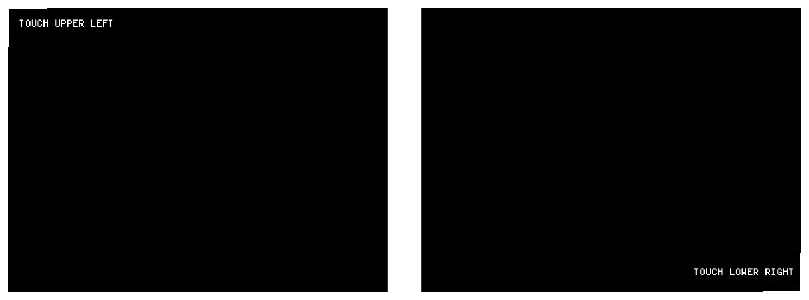

You can then test the LCD touch panel stylus tracking accuracy by selecting **CONFIG → TOUCH** **TEST.**

A line is drawn while dragging the stylus along the touch panel. When released from the touch panel, it returns to its original state. Repeat & save the touch screen calibration if tracking is incorrect.

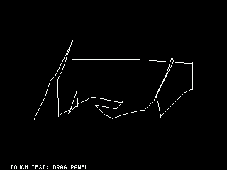

# 3 - Performing measurements

The basic measurement sequence is:

## 1. Set the frequency range to be measured. Use STIMILUS → START/STOP or STIMILUS → SPAN/CENTER

## 2. Perform calibration (and save!)

## 3. Connect the Device Under Test (DUT) and measure.

## Setting the measurement frequency range

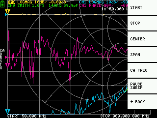

There are three types of measurement range settings.

- Setting the start frequency and stop frequency

- Setting the center frequency and span

- Zero span

### Setting the start frequency and stop frequency

Select and set **STIMULUS → START** and **STIMULUS → STOP,** respectively.

### Setting the center frequency and span

Select and set **STIMULUS → CENTER** and **STIMULUS → SPAN,** respectively.

### Zero span

Zero span is a mode in which one frequency is sent continuously without frequency sweep. Select and set **STIMULUS → CW FREQ.**

### Temporarily stop measurement

When menu item **PAUSE SWEEP** is active, measurement is temporarily stopped.

## Calibration

Calibration must be performed whenever the frequency range to be measured is changed. When calibration is activated, the left side of the screen should show "Cx" and "D".

Changing the frequency sweep range always clears the active calibration, if any.

The calibration procedure is as follows:

1. Reset current calibration state. Select menu item CAL →RESET and then →CALIBRATE.

2. Attach a SMA coaxial cable to port 1.

3. (Optional) Attach a SMA coaxial cable to port 2.

4. Connect OPEN standard to port 1 cable and click →OPEN. Wait for menu item highlight.

5. Connect SHORT standard to port 1 cable and click →SHORT. Wait for menu item highlight.

6. Connect LOAD standard to port 1 cable and click →LOAD. Wait for menu item highlight.

7. (Optional) Connect the THRU standard between the port 1 and port 2 cable ends, and click **→THRU.**

## 8. Click →DONE.

9. Specify the dataset number (0 to 4) and save. e.g. →SAVE 0.

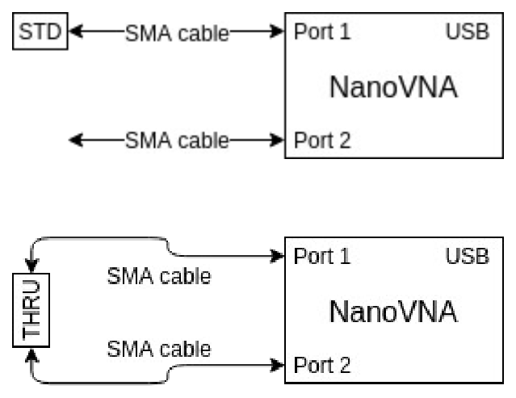

#### Measuring a calibration standard

#### Measuring the THRU standard

Note that there is no need to wait for the plots to fully update after connecting a calibration standard. Clicking any of the OPEN, SHORT, LOAD, THRU calibration menu items will perform a full sweep with 2x averaging. Once the sweep is complete the corresponding menu item will become highlighted, and you may proceed to the next calibration standard.

## Trace display

Up to four traces can be displayed, one of which is the active trace. You can turn on/off traces as needed. The menu items **DISPLAY →TRACE →TRACE n** allow you to activate as well as turn on/off traces. When a trace is active, its channel name at the top of the screen is highlighted. In the image above, TRACE 0 is the active trace. Clicking **DISPLAY →TRACE →TRACE n** on the current active trace will turn it off. Clicking any other trace activates it.

### Trace format

Although each trace can have its own displayed format, you can only change the format of the active trace. To assign a format, set the trace to active (see above) then select: **DISPLAY →FORMAT** The description and unit of measurement of each format is as follows:

- LOGMAG : Logarithm of absolute value of measured value (dB per div)

- PHASE : Phase in the range of -180 ° to + 180 ° (90 degree default)

- DELAY : Delay (pico or nano seconds)

- SMITH : Smith Chart (Impedance scale is normalized during calibration)

- SWR : Standing Wave Ratio (can be scaled to show 1, 0.1 or 0.01 per div)

- POLAR : Polar coordinate format (Impedance scale is normalized during calibration)

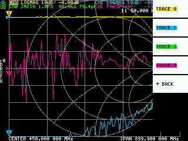

- LINEAR : Absolute value of the measured value

- REAL : Real part of measured S parameter

- IMAG : Imaginary part of measured S parameter

- RESISTANCE : Resistance component of the measured impedance (ohms per div)

- REACTANCE : Reactance component of the measured impedance (ohms per div)

### Trace channel

The S-A-A-2 has two channels, **CH0** and **CH1,** corresponding to ports 1 and 2.

**CH0** is the S parameter **S11,** while **CH1** is the S parameter **S21.**

Each trace can be set to display data from either channel.

To change the channel used by the currently active trace, select

**DISPLAY →CHANNEL →CH0 REFLECT** or **DISPLAY →CHANNEL →CH1 THROUGH.**

## Markers

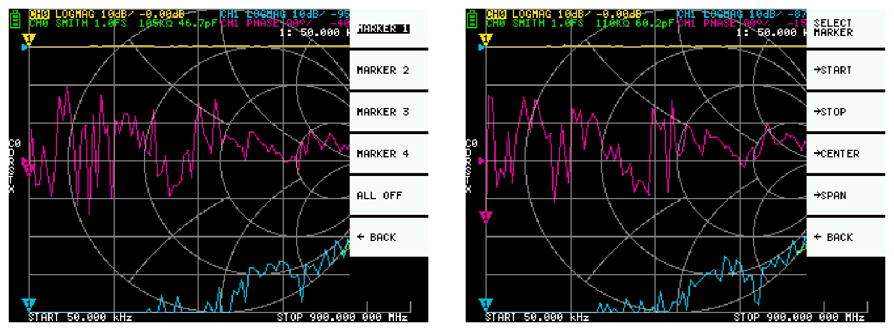

Up to 4 markers can be displayed. Markers are selected by the menu items **MARKER →SELECT MARKER →MARKER n** . Clicking on a disabled marker menu item enables it and makes it active. Clicking on an enabled but non-active marker activates it. Clicking on the currently active marker disables it.

### Setting frequencies from marker(s)

You can set the frequency range from the **MARKER →OPERATIONS** menu as follows:

- OPERATIONS →START - Sets the start frequency to the active marker's frequency.

- OPERATIONS →STOP - Sets the stop frequency to the active marker's frequency.

- OPERATIONS →CENTER - Sets the frequency of the active marker to be the center frequency.

- OPERATIONS →SPAN - Sets the absolute frequency span to the last two active markers. You need to have any two markers (M1-M4) enabled for the Span button to work. If only one marker is displayed, nothing happens.

## Time domain operation

The S-A-A-2 can simulate time domain reflectometry by transforming frequency domain data. Select **DISPLAY →TRANSOFRM →TRANSFORM ON** to convert measured data to the time domain. If **TRANSFORM ON** is enabled (Inverted white text on black background), the measurement data is immediately converted to the time domain and displayed. The relationship between the time domain and the frequency domain is as follows.

- Increasing the maximum frequency increases the time resolution

- The shorter the measurement frequency interval (ie, the lower the maximum frequency), the longer the maximum time length

For this reason, the maximum time length and time resolution are in a trade-off relationship. In other words, the time length is the distance.

- If you want to increase the maximum measurement distance, you need to lower the frequency spacing (frequency span / sweep points).

- If you want to measure the distance accurately, you need to increase the frequency span.

**HINT** – Use a lower frequency to measure a longer length and a higher frequency to measure a shorter length and adjust accordingly for accurate results.

### Time domain bandpass

In bandpass mode, you can simulate the DUT response to an impulse signal.

**NOTE:** The trace format can be set to **LINEAR, LOGMAG** or **SWR.**

The following is an example of the impulse response of a bandpass filter.

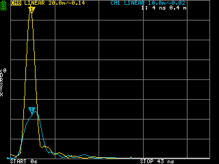

### Time domain low pass impulse

In low-pass mode, you can simulate TDR. In low-pass mode, the start frequency must be set to 50 kHz, and the stop frequency must be set according to the distance to be measured.

The trace format can be set to **REAL.**

Examples of Impulse response in open state and impulse response in short state are shown below.

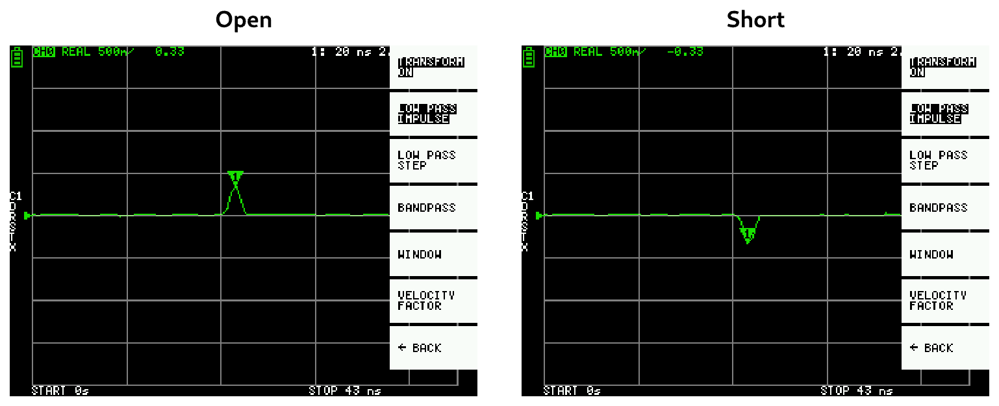

### Time domain low pass step

The trace format can be set to **REAL.**

Example measurements of Step response are shown below.

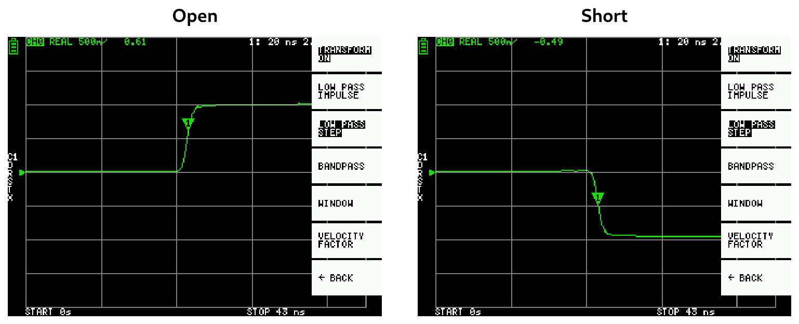

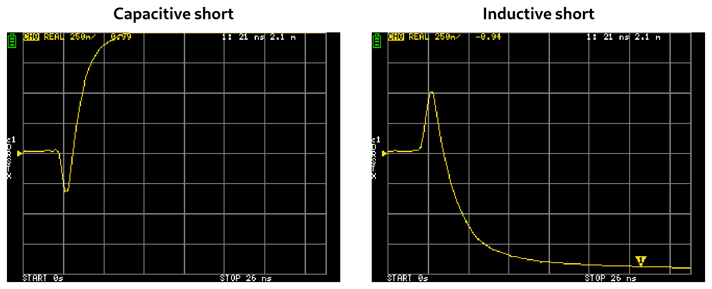

#### Capacitive short Inductive short

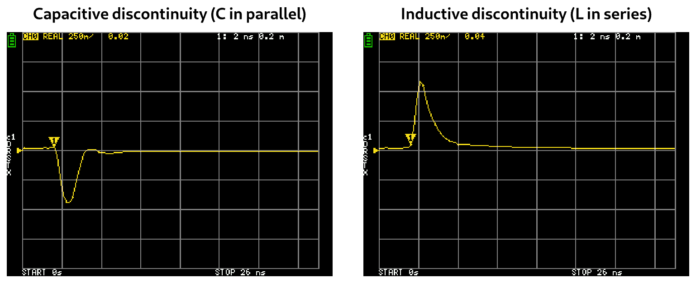

#### Capacitive discontinuity (C in parallel) Inductive discontinuity (L in series)

### Time domain window

The range that can be measured is a finite number, and there is a minimum frequency and a maximum frequency. A window can be used to smooth out this discontinuous measurement data and reduce ringing.

There are three levels of windowing.

- MINIMUM (no window, ie: same as rectangular window)

$$• NORMAL (equivalent to Kaiser window \beta = 6)$$

$$• MAXIMUM (equivalent to Kaiser window \beta = 13)$$

**MINIMUM** provides the highest resolution and **MAXIMUM** provides the highest dynamic range. **NORMAL** is in the middle.

### Setting the velocity factor in the time domain

The transmission speed of electromagnetic waves in the cable varies depending on the material. The ratio to the transmission speed of electromagnetic waves in vacuum is called the Velocity Factor. This is always stated in the cable specifications.

In the time domain, the displayed time can be converted into distance. The wavelength shortening ratio used for distance display can be set with **DISPLAY → TRANSFORM → VELOCITY FACTOR** .

For example, if you measure the TDR of a cable with a wavelength reduction rate of 67%, specify **67** for the **VELOCITY FACTOR.** (Do not use the decimal point).

## Recall calibration and settings

Up to 5 calibration datasets can be saved.

Calibration data includes the following information:

- Frequency range setting

- Error correction at each measurement point

- Trace settings

- Marker settings

- Domain mode settings

- Electrical delay

You can save the current settings by selecting **CAL → SAVE → SAVE n.**

Current calibration data can be reset by selecting **CAL → RESET.**

**CAL → CORRECTION** indicates whether error correction is currently enabled. You can deselect this

to temporarily disable error correction. (Inverted text=ON, Normal text=OFF) **RECALL** the saved settings by selecting **CAL → RECALL → RECALL n.**

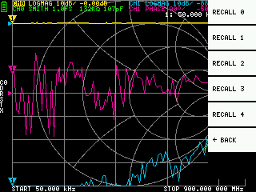

# 4 - NanoVNA-QT Software

- This chapter describes the usage of the NanoVNA-QT PC software with the S-A-A-2.

- NanoVNA-QT is derived from software for the xaVNA.

- Platforms supported: Linux, Windows (7+), Mac OS (10.11+)

## User interface

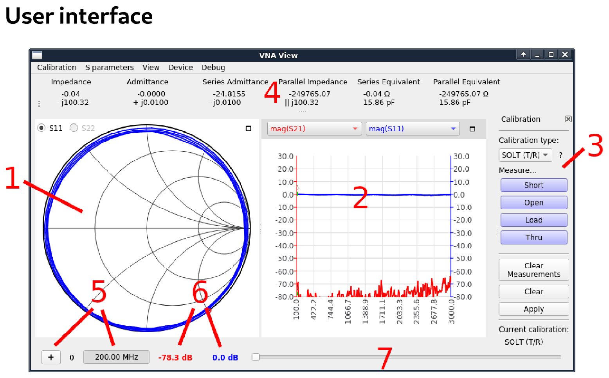

#### 1 – Smith chart display

Shows a smith chart of S11 or S22 depending on the radiobutton selected.

#### 2 – Line graph display

Shows a line graph plot of two user selected traces. The two dropdown lists above the graph select the data source displayed. The color of the trace corresponds to the color of the dropdown.

#### 3 – Calibration pane

Allows you to measure calibration standards and enable/disable calibration.

#### 4 – Impedance display

Shows impedance values and series/parallel equivalent circuits calculated from S11.

#### 5 – Marker control 6 – Marker values

The "+" button adds a new marker. Clicking on the frequency indicator will show/hide the marker dot. Labels show the numeric value of each line graph trace at the current marker frequency.

#### 7 – Marker slider

Adjust this slider to control marker position.

## Connecting to the device

After connecting the device to the PC using a USB cable, a new serial port device should show under the **Device** menu in NanoVNA-QT. If no device shows up, you may need to install the Cypress USB Serial driver (can be found on NanoVNA-QT binary release downloads). The device uses the USB CDC class, which does not require dedicated drivers on Linux and Mac OS.

Select the device under the **Device** menu to connect to it. Continuous sweep will start immediately and you should see continuously updating data on the smith chart and line plots.

## Setting sweep range and parameters

Click **Device > Sweep parameters…** from the main menu to bring up the Sweep Parameters dialog.

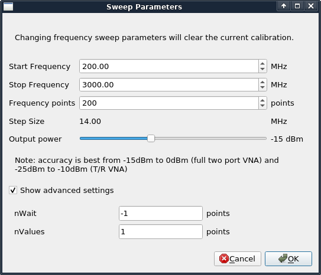

Settings:

- Start frequency/Stop Frequency control the sweep frequency range.

- Frequency points is the number of discrete frequency points.

- Output power is not applicable to the S-A-A-2 and the setting is ignored.

Under **Show advanced settings:**

- nWait is not applicable to the S-A-A-2 and the setting is ignored.

- nValues controls the number of data points per sweep point to average over. Setting a higher averaging factor will result in proportionally lower noise and higher sweep times.

## Calibration

Calibration in the NanoVNA-QT UI is similar to the on-device UI.

Calibration must be performed whenever the frequency range to be measured is changed. When calibration is activated, the label under "Current calibration" in **3 – Calibration pane** will indicate the current calibration type. "None" indicates no calibration is active.

Changing the frequency sweep range always clears the active calibration, if any.

The calibration procedure is as follows:

1. Reset current calibration. Click Clear and Clear Measurements under 3 – Calibration pane.

2. Select Calibration type. Use SOL (1 port) to correct for S11 only, and use SOLT (T/R) to correct for S11 and S21 response. Other calibration types in the dropdown list apply to full two port VNAs only and are not applicable to the S-A-A-2 which is a T/R VNA.

## 3. Attach a SMA coaxial cable to port 1.

4. (SOLT only) Attach a SMA coaxial cable to port 2.

5. Connect OPEN standard to port 1 cable and click Open. Wait for button highlight.

6. Connect SHORT standard to port 1 cable and click Short. Wait for button highlight.

7. Connect LOAD standard to port 1 cable and click Load. Wait for button highlight.

8. (SOLT only) Connect the THRU standard between the port 1 and port 2 cable ends, and click **Thru.** Wait for button highlight.

## 9. Click Apply.

Refer to the figures in section 3.1.Calibration for how to connect the calibration standards.

Note that there is no need to wait for the plots to fully update after connecting a calibration standard. Clicking any of the **Open, Short, Load, Thru** buttons will perform a full sweep with 2x averaging. Once the sweep is complete the button will become highlighted, and you may proceed to the next calibration standard.

To save the current calibration click **Calibration > Save as…** in the main menu.

To recall a saved calibration click **Calibration > Load…** in the main menu. Recently saved or recalled calibrations will also be listed under the **Calibration** menu and can be selected directly.

Saved calibration files contain the measurements for each calibration standard. Recalling a saved calibration file will calculate a new calibration using the old (saved) measurements and the currently configured calibration kit parameters.

### Calibration kit parameters

NanoVNA-QT supports user calibration kit parameters. Click Calibration > Kit settings under main menu to open the **Calibration kit parameters** dialog.

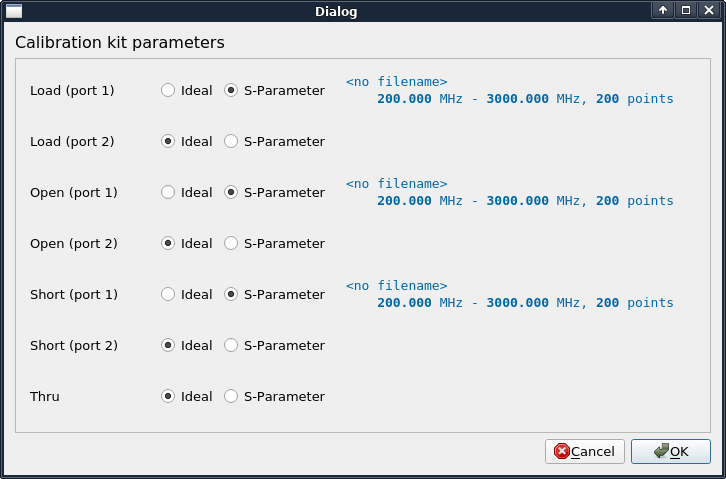

Each calibration kit type can be associated with an S parameter model, or an ideal model can be used. Clicking on the S-Parameter radio button will bring up a file chooser dialog to select the S parameter file.

**Note:** these kit parameters are global and are not associated with a calibration save file. If you modify kit parameters and proceed to recall an older calibration file, the old calibration will be recalculated using the newly configured kit parameters!

## Firmware Update

The NanoVNA-QT software has built in support for updating the firmware on the S-A-A-2. To perform a firmware update:

## 1. Connect the device to a PC using a USB cable.

2. Put the device into DFU mode. This can be done from the device menu by selecting CONFIG **→DFU,** and selecting **RESET AND ENTER DFU.** DFU mode can also be entered by holding down the **JOG LEFT** button on the device while it is powered off and on.

3. The device should appear under the Device menu in NanoVNA-QT.

4. Click the device under the Device menu, for example /dev/ttyACM0.

5. You will be prompted to update the device firmware. Answer "yes" or "update firmware".

6. You will be prompted to select a firmware raw binary file. Select the file you wish to flash.

7. Firmware update will begin and progress is shown in NanoVNA-QT.

8. If the firmware update fails or is interrupted, go to step 2 and retry.

9. After the firmware update is complete, the device will automatically reboot into the new firmware. You can now connect to the device in NanoVNA-QT.

5 - Appendix I – Hardware architecture

# 5 - Appendix I – Hardware architecture

The S-A-A-2 is a highly cost optimized design that aims to achieve the best possible RF performance within a tight BOM budget.

The following block diagram shows a high level overview of the system.

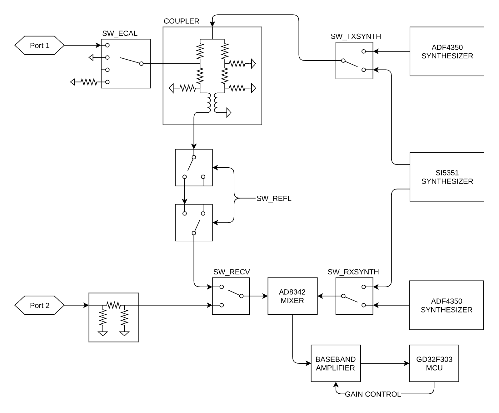

SW_ECAL SW_TXSYNTH

Port 1 ADF4350

SYNTHESIZER

The S-A-A-2 is a single switched receiver VNA. While the diagram shows only two channels selectable by the receive mixer through SW_RECV, a third channel, the reference channel, is provided by setting SW_ECAL to the "open circuit" position. By controlling these two switches the receiver is able to observe reference, reflected, and thru signals.

5 - Appendix I – Hardware architecture

### Signal generators

Two ADF4350 RF synthesizers, plus one Si5351, provide the stimulus and LO signals. The Si5351 covers frequencies up to 140MHz, and the rest are covered by the ADF4350s.

### Directional coupler

The coupler is based on a Wheatstone bridge rearranged so that input and DUT ports are referenced to ground. The coupled signal exists as a difference signal and is extracted by baluns. Two stages of baluns are used to achieve the necessary common mode rejection ratio.

### Receiver

The receiver consists of a AD8342 mixer and an op-amp based baseband amplifier.

The mixer downconverts the RF signal to a low but nonzero intermediate frequency (typically 12kHz). The IF signal is digitized using the built in 12 bit ADCs on the GD32 microcontroller.

Firmware on the microcontroller digitially detects the phase and magnitude of the IF, and thus RF signal, which results in superior accuracy compared to VNAs using a phase and magnitude detector IC that does the detection in the analog domain.

# 6 - Appendix II – USB data interface

The S-A-A-2 appears as a USB CDC (Communications Device Class) virtual serial port both during normal operation and in DFU mode. PC software can issue commands and request data by sending and receiving data on the virtual serial port. Communications protocol is identical in the two cases, with only register layouts differing.

## Protocol description

Only the host may initiate commands by sending one or more bytes on the virtual serial port. Each command may have a different length. There is no separator delimiting each command.

The device may not send data to the host except for replies to a host-to-device command.

The following table lists all supported commands and their byte encodings, and is applicable both during normal operation and in DFU mode.

## Host to device command list

All byte values in the table are in hexadecimal. B0 to B5 denote bytes 0 to 5. B0 is the opcode.

| B0 | B1 | B2 | B3 | B4 | B5 | Name | Description |
| --- | --- | --- | --- | --- | --- | --- | --- |
| 00 | - | - | - | - | - | NOP | No operation |
| 0d | - | - | - | - | - | INDICATE | Device always replies with ascii ‘2’ (0x32) |
| 10 | (AA) | - | - | - | - | READ | Read a 1-byte register at address AA. Reply is one byte, the read value. |
| 11 | (AA) | - | - | - | - | READ2 | Read a 2-byte register at address AA. Reply is 2 bytes, the read value. |
| 12 | (AA) | - | - | - | - | READ4 | Read a 4-byte register at address AA. Reply is 4 bytes, the read value. |
| 18 | (AA) | (NN) | - | - | - | READFIFO | Read NN values from a FIFO at address AA. Reply is the read values in order. Each value can be more than one byte and is determined by the FIFO being read. |
| 20 | (AA) | (XX) | - | - | - | WRITE | Write XX to a 1-byte register at address AA. There is no reply. |
| 21 | (AA) | (X0) | (X1) | - | - | WRITE2 | Write X0 to AA, then X1 to AA+1. There is no reply. |
| 22 | (AA) | (X0) | (X1) | (X2) | (X3) | WRITE4 | Write X0..X3 to registers starting at AA. There is no reply. |
| 23 | (AA) | (X0) | (X1) | (X2) | ... | WRITE8 | This command is 10 bytes in total. Bytes 2..9 correspond to X0..X7. Write X0..X7 to registers starting at AA. There is no reply. |
| 28 | (AA) | (NN) | … |  |  | WRITEFIFO | Write NN bytes into a FIFO at address AA. NN bytes of data to be written into the FIFO should follow “NN”. There is no reply. |

## Register descriptions

The following table lists all registers accessible during normal operation.

All addresses are in hexadecimal.

Multi-byte integer registers are encoded in Little Endian. Lowest numbered registers contain the

least significant portions of the integer.

| Address | Name | Description |
| --- | --- | --- |
| 00..07 | sweepStartHz | Sets the sweep start frequency in Hz. uint64. |
| 10..17 | sweepStepHz | Sets the sweep step frequency in Hz. uint64. |
| 20..21 | sweepPoints | Sets the number of sweep frequency points. uint16. |
| 22..23 | valuesPerFrequency | Sets the number of data points to output for each frequency. uint16. |
| 26 | rawSamplesMode | Writing 1 switches USB data format to raw samples mode and leaves this protocol. |
| 30 | valuesFIFO | Returns VNA sweep data points. Each value is 32 bytes. Writing any value (using WRITE command) clears the FIFO. See FIFO data format section below. |
| f0 | deviceVariant | The type of device this is. Always 0x02 for S-A-A-2. |
| f1 | protocolVersion | Version of this wire protocol. Always 0x01. |
| f2 | hardwareRevision | Hardware revision. |
| f3 | firmwareMajor | Firmware major version. |
| f4 | firmwareMinor | Firmware minor version. |

**Remarks** **sweepStartHz, sweepStepHz,** and **sweepPoints** together set the sweep parameters of the VNA. Writing any value to these registers will immediately terminate the on-device UI and put the device in "USB data mode", where the PC has full control over VNA operation. You can not observe user entered sweep parameters (from the device UI) by reading these registers. Sweep is always running and can not be paused.

### FIFO data format

The values read from **valuesFIFO** are 32 bytes each. The following table lists the fields in each value. All byte offsets are in hexadecimal. All multi-byte integers are encoded in Little Endian. Lowest numbered bytes contain the least significant portions of the integer.

| Bytes Name | Description | Type |
| --- | --- | --- |
| 00..03 fwd0Re | Real part of channel 0 outgoing wave. | int32 |
| 04..07 fwd0Im | Imaginary part of channel 0 outgoing wave. | int32 |
| 08..0b rev0Re | Real part of channel 0 incoming wave. | int32 |
| 0c..0f rev0Im | Imaginary part of channel 0 incoming wave. | int32 |
| 10..13 rev1Re | Real part of channel 1 incoming wave. | int32 |
| 14..17 rev1Im | Imaginary part of channel 1 incoming wave. | int32 |
| 18..19 freqIndex | Frequency index, 0 to sweepPoints - 1. | uint16 |
| 1a..1f (reserved) | (reserved) | - |

**valuesFIFO** is continuously being filled with new sweep data regardless of whether it is being read. If you wish to do on-demand sweeps, it is necessary to clear stale data before reading from the FIFO. The FIFO can be cleared by writing (with the **WRITE** command) any value to the FIFO address.

**valuesFIFO** returns raw values representing the in-phase and quadrature part of the measured waves, which never have user calibration applied. You can not access the on-device user calibrations or calibrated data over USB.

**fwd0Re/fwd0Im** is referred to as the reference channel. All complex values read from **valuesFIFO** can be at a random phase, so you must divide (using complex division) each value by the reference channel to get absolute phase and magnitude values.

## Register descriptions (DFU mode)

The following table lists all registers accessible in DFU mode.

All addresses are in hexadecimal.

Multi-byte integer registers are encoded in Little Endian. Lowest numbered registers contain the

least significant portions of the integer.

| Address | Name | Description |
| --- | --- | --- |
| e0..e3 | flashWriteStart | Current flash write address. uint32. Set this to the address to start writing at. |
| e4 | flashFIFO | Writing to this FIFO will write data into flash starting at flashWriteStart. flashWriteStart will be incremented by the number of bytes written. |
| e8..eb | userArgument | The user argument to pass to the program upon soft reset. uint32. |
| ef | doReboot | Write 0x5e to initiate a soft reset. |
| f0 | deviceVariant | The type of device this is. Always 0x02 for S-A-A-2. |
| f1 | protocolVersion | Version of this wire protocol. Always 0x01. |
| f2 | hardwareRevision | Hardware revision. Always 0x00 in DFU mode. |
| f3 | firmwareMajor | Firmware major version. Always 0xff in DFU mode. |
| f4 | firmwareMinor | Firmware minor version (of the bootloader). |

### Writing to flash

The procedure to write a new firmware image to flash are as follows.

1. Connect the device to the PC over USB and put the device into DFU mode.

2. Open the virtual serial port in raw mode (platform specific).

3. Write the address you wish to start flashing from to flashWriteStart.

4. Use the WRITEFIFO command to send up to 255 bytes at a time to flashFIFO. Each **WRITEFIFO** command can be followed with a **INDICATE** command, which will reply with '2' only after the flash operation is complete. There is no flow control on the virtual serial port and you must limit the amount of outstanding writes to no more than 2048 bytes.

5. (Optional) Write 0x5e to doReboot to soft reset the device.

---

## Repeated content (headers / footers / watermarks)

> The following appeared on most pages and was moved out of the body to keep reading order clean — kept here, not deleted.

- UG1101 2020/01 1 · UG1101 2020/01 2 · UG1101 2020/01 3 · UG1101 2020/01 4 · UG1101 2020/01 5 · UG1101 2020/01 6 · UG1101 2020/01 7 · UG1101 2020/01 8 · UG1101 2020/01 9 · UG1101 2020/01 10 · UG1101 2020/01 11 · UG1101 2020/01 12 · UG1101 2020/01 13 · UG1101 2020/01 14 · UG1101 2020/01 15 · UG1101 2020/01 16 · UG1101 2020/01 17 · UG1101 2020/01 18 · UG1101 2020/01 19 · UG1101 2020/01 20 · UG1101 2020/01 21 · UG1101 2020/01 22 · UG1101 2020/01 23 · UG1101 2020/01 24 · UG1101 2020/01 25 · UG1101 2020/01 26 · UG1101 2020/01 27 · UG1101 2020/01 28 · UG1101 2020/01 29 · UG1101 2020/01 30 · UG1101 2020/01 31 · UG1101 2020/01 32 · UG1101 2020/01 33 · UG1101 2020/01 34 · UG1101 2020/01 35 · UG1101 2020/01 36  *(pp.1–36)*
- 1 - Introduction  *(pp.3–5)*
- 2 - User interface  *(pp.6–11)*
- 3 - Performing measurements  *(pp.12–22)*
- 4 - NanoVNA-QT Software  *(pp.23–29)*
- 6 - Appendix II – USB data interface  *(pp.32–36)*