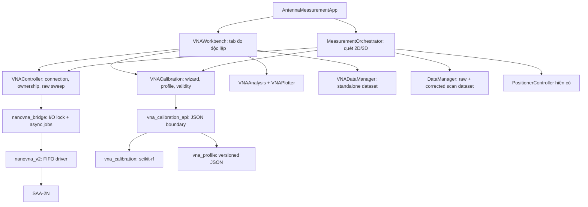
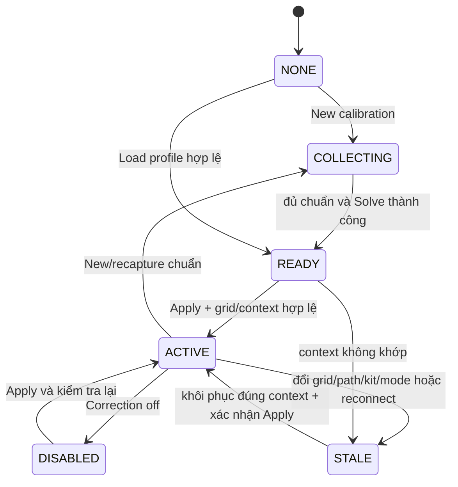

# Thiết kế tích hợp VNA vào hệ thống đo anten

Ngày: 2026-10-15, Asia/Bangkok. Tài liệu này là hợp đồng thiết kế; các mô tả baseline bên dưới ghi lại lúc khảo sát. Implementation và bằng chứng hiện tại ở [nhật ký triển khai](../../vna-workbench-implementation-log.md). Kiểm chứng phần cứng: NOT_RUN.

## 1. Mục tiêu và cơ sở

App MATLAB có một chế độ VNA độc lập để đo S11/S21, hiệu chuẩn Open/Short/Load/Thru trên PC, xem Smith/LogMag/Phase/VSWR, lưu/nạp hiệu chuẩn và dùng cùng hiệu chuẩn trong quét anten 2D/3D. Giao diện phải phân biệt dữ liệu thô, S11 đã sửa và S21 đã sửa theo mô hình T/R. Người dùng thực hiện thay đầu chuẩn; phần mềm thu mẫu, giải hệ số, kiểm tra điều kiện dùng lại và lưu bằng chứng.

Baseline đã đọc: branch `codex/ver2-pan-tilt-3d`, commit `7ea2f9e55568c154f2689091c49566858dce3309`. Trước triển khai phải đọc lại HEAD và diff; không reset về commit này. Tại lúc khảo sát, tracked working tree sạch; có thể thay đổi sau đó.

Những điều đã có:

- `python/nanovna_v2.py`: driver binary FIFO SAA-2N; tỷ số REV/FWD là raw, chưa áp user calibration.
- `python/nanovna_bridge.py:_result_to_dict`: đã kiểm tra đủ index và sắp xếp đồng thời frequency/S11/S21. Giữ bản sửa trong `docs/superpowers/plans/2026-10-15-vna-frequency-grid.md`.
- `matlab/classes/VNAController.m`: API MATLAB Real/Mock, sweep đồng bộ, mock pattern 2D/3D.
- `matlab/app/AntennaMeasurementApp.m`: classic `figure/uicontrol/uitab/axes`, không phải App Designer `uifigure`; RF monitor hiện chủ yếu là magnitude tại góc peak sau scan.
- `MeasurementOrchestrator`: quét 2D/3D, STOP/pause, encoder gates và dữ liệu partial. 3D dùng lưới frequency thực; 2D còn tạo `linspace`, cần sửa khi tích hợp hiệu chuẩn.
- `DataManager`: MAT/CSV/JSON và nạp dataset cũ. `S11/S21` hiện mang nghĩa raw.
- Python thực tế: `C:\Users\Spooky Laptop\AppData\Local\Programs\Python\Python313\python.exe`, 3.13.13; pyserial 3.5, NumPy 2.5.3; chưa có scikit-rf/SciPy tại thời điểm lập kế hoạch. MATLAB R2025b; phải thử import/tính toán qua chính `pyenv` khi triển khai.

## 2. Phạm vi và quyết định thiết kế

Đây là các lựa chọn kỹ thuật do người lập kế hoạch đề xuất, không phải những chi tiết người dùng đã tự chọn:

1. Giữ MATLAB GUI và driver FIFO hiện tại; thêm scikit-rf **2.1.0** làm engine hiệu chuẩn. Không nhúng GUI QT/Saver, không đổi driver sang PyVISA trong đợt này.
2. Tên chế độ: `RAW`, `SOL`, `TR`. UI tương ứng: `Chưa hiệu chuẩn`, `SOL — S11`, `SOLT T/R — S11 + S21 chiều thuận`.
3. SOL dùng `skrf.OnePort`; TR dùng `skrf.TwoPortOnePath(..., source_port=1, n_thrus=1)` với một network forward khi áp dụng, tức **enhanced response partial correction**. Không tuyên bố full two-port correction. Cả hai dùng đúng một lần sửa trên raw.
4. Hồ sơ chính là `.vnacal.json`, self-contained, schema 1, lưu raw chuẩn, mô hình chuẩn và hệ số. Không cần pickle để dùng app; import/export `.cal` không thuộc đợt này. Đây là lựa chọn lưu bền vững hơn đề xuất `.cal` dùng nhanh trong cuộc trao đổi trước.
5. VNA workbench có Single/Continuous/Stop, averages 1..16; mặc định 1, thu chuẩn mặc định 4. Hardware vẫn `values_per_freq=1`; averaging là trung bình **complex** của nhiều sweep đủ điểm.
6. Phạm vi GUI mới và scan đã tích hợp: 50,000..3,000,000,000 Hz; 2..401 điểm; start < stop; bước thực nguyên Hz >=1. Đây là giới hạn sản phẩm ban đầu, không phải khẳng định 401 là giới hạn phần cứng. Không segmented sweep/CW trong đợt này.
7. Smith dùng axes MATLAB thường, vẽ từ complex S11; không bắt buộc RF Toolbox. Chuẩn kit đầu tiên là ideal 50 ohm có nhãn `Giả định chuẩn lý tưởng`; hỗ trợ kit characterized từ Touchstone trong bước riêng trước khi bàn giao hoàn chỉnh.
8. Scan mặc định `RAW` để giữ hành vi cũ. Chọn SOL/TR là yêu cầu bắt buộc: sai/mất calibration phải dừng, không âm thầm chuyển raw. Quét góc tiếp tục dùng averages=1 ở đợt này.

Chưa làm: S12/S22 tự động, full SOLT 12-term của VNA hai chiều, TDR/time gating, port extension, de-embedding, gain tuyệt đối, uncertainty budget, nâng cấp firmware, thay đổi cơ khí, giao diện web, sửa kiến trúc positioner. Đây là giai đoạn tiếp theo, không phải việc model được tự thêm.

## 3. Kiến trúc



`VNAController.Calibration` là **một instance VNACalibration** dùng chung bởi workbench và orchestrator. Không có engine hiệu chuẩn thứ hai tự lấy COM. Thay VNAController khi đổi Real/Mock phải thay reference trong cả orchestrator/workbench và clear session calibration.

## 4. Hợp đồng dữ liệu

### 4.1 Sweep request và lưới tần số

MATLAB request struct: `StartHz`, `StopHz`, `Points`, `Averages`, `MockStandard` (`DUT|OPEN|SHORT|LOAD|THRU`, chỉ Mock). Start/stop là double nhưng phải hữu hạn, nguyên Hz; points/averages phải là số nguyên trước khi cast. Dữ liệu truyền Python JSON dùng snake_case tương ứng.

Lưới thực: `step = floor((StopHz-StartHz)/(Points-1))`; `f = StartHz + (0:Points-1)*step`. Hiển thị `ActualStopHz=f(end)` nếu khác StopHz. Không dùng `linspace` để giả lập lưới hardware, không gắn hệ số cal theo index trên lưới khác. Profile và sweep phải cùng vector Hz **chính xác**. Đợt này không tự nội suy/ngoại suy cal hoặc file kit.

`averages` được lưu để truy xuất phép đo; khác số averages không tự làm profile stale vì không thay lưới hoặc RF path. Đổi frequency grid/kit/Z0/path/firmware/Mock model làm stale.

### 4.2 Raw sweep và kết quả

Giữ mọi field API MATLAB cũ (`FrequencyHz`, `S11`, `S21`, dB, phase, `PointsReceived`, `Complete`), trong đó `S11/S21` **luôn raw**. Append `CapturedAtUTC` (ISO8601), `Averages`, `Mode`, `AcquisitionId`. Vectors MATLAB là row; Python là list 1D. `Complete=true` chỉ khi đủ một điểm ở mỗi frequency và mọi complex sample hợp lệ. FWD0=0 phải thành lỗi tại bridge, không thành S11=S21=0 giả.

Kết quả standalone `measurement`:

| Field | Ý nghĩa |
|---|---|
| `SchemaVersion` | 1 |
| `Raw` | raw sweep struct trên, bất biến |
| `CorrectedS11`, `CorrectedS21` | complex row N điểm, hoặc `[]` nếu kênh chưa sửa |
| `ChannelState` | struct `S11`, `S21`: `RAW|SOL|TR_ENHANCED_RESPONSE` |
| `CalibrationProfile` | full profile snapshot, hoặc empty struct |
| `CalibrationProfileId` | UUID hoặc empty string |
| `CalibrationProfileJSON` | chuỗi JSON canonical gốc từ Python để lưu lại; empty nếu RAW |
| `Context` | điều kiện kết nối/path/kit/mode |
| `ViewSource` | `RAW|CORRECTED`; CORRECTED chỉ chọn kênh có correction, kênh còn lại ghi RAW |

Error boundary Python: `{"status":"OK","payload":...}` hoặc `{"status":"ERROR","code":"...","message":"..."}`. Không JSON NaN/Infinity, không serial Python exception object. New errors có code ổn định: `INVALID_REQUEST`, `INVALID_SWEEP`, `ZERO_REFERENCE`, `BUSY`, `CANCELLED`, `GRID_MISMATCH`, `MISSING_STANDARD`, `DEGENERATE_STANDARDS`, `INVALID_PROFILE`, `ENGINE_VERSION_MISMATCH`, `CONTEXT_MISMATCH`, `BACKEND_UNAVAILABLE`. MATLAB chuyển thành `VNA:<code>`; API legacy bridge vẫn giữ kiểu return/error hiện tại.

JSON chỉ truyền/lưu projection raw gồm frequency, real/imag và acquisition metadata nêu ở §4.3; bỏ toàn bộ dB/phase/VSWR/Z suy ra. MATLAB tính lại các đại lượng này sau decode. `metadata.json` không chứa arrays đại lượng suy ra; MAT giữ được Inf/NaN, CSV ghi rõ `Inf`, `-Inf`, `NaN`. Zero complex là mẫu hợp lệ nếu reference khác zero; không đổi zero thành epsilon để qua JSON.

### 4.3 Profile `.vnacal.json`

UTF-8 JSON, kích thước tối đa 10 MiB; không pickle/eval. Complex arrays biểu diễn `{"real":[...],"imag":[...]}`. Mọi số hữu hạn, mọi vector cùng N và đúng thứ tự frequency. Cấu trúc bắt buộc:

```text
schema_version = 1
profile_id = UUID4; name; created_at_utc
algorithm = SOL_1PORT | TR_ENHANCED_RESPONSE
engine = {name:"scikit-rf", version:"2.1.0", adapter_version:1}
frequency_hz = [actual integer Hz...]; z0_ohm = 50.0
context = {mode, instrument_label, device_variant, protocol_version,
           hardware_revision, firmware_major, firmware_minor,
           port_at_capture, rf_path_id, reference_plane, mock_model}
kit = {kind:"IDEAL_50OHM"|"CHARACTERIZED", name,
       assumption_note, source_files:[basename+sha256...],
       models:{open,short,load[,thru]}}
standards = {open:{raw sweep}, short:{raw sweep}, load:{raw sweep}[,thru:{raw sweep}]}
coefficients = {scikit-rf coefficient name: complex array...}
validation = {status:"NOT_CHECKED"|"CHECKED", evidence_ids:[], note}
content_sha256 = hash canonical JSON excluding this field
```

`port_at_capture` là provenance, không phải unique hardware identity. Device registers không chứng minh máy vật lý duy nhất; bắt buộc nhập `instrument_label`, `rf_path_id`, `reference_plane` không rỗng khi tạo cal Real. Sau load/reconnect, người dùng xác nhận đang dùng đúng máy/cáp/mặt phẳng đã lưu trước khi activate. Không tự bật cal từ lần chạy trước. Mock profile không activate cho Real và ngược lại.

`standards.<name>` dùng wire raw schema hiện có của bridge: `frequency_hz`, `s11_real`, `s11_imag`, `s21_real`, `s21_imag`, `points_received`, `complete`, thêm `captured_at_utc`, `averages`, `mode`, `acquisition_id`; không lưu dB/phase đã suy ra. `kit.models.open/short/load` là complex gamma array; `kit.models.thru` là dict bốn complex arrays `s11/s21/s12/s22` mô tả chuẩn đã biết, không phải bốn kênh được SAA-2N đo. Defaults ideal: open=+1, short=-1, load=0, thru s11=s22=0 và s21=s12=1.

Hash canonical: Python `json.dumps(data_without_hash, sort_keys=True, separators=(',', ':'), ensure_ascii=False, allow_nan=False)` encoded UTF-8. Hash phát hiện hỏng file, không phải chứng nhận đo lường hay chữ ký tin cậy. Mọi save thực hiện temp sibling + `os.replace` sau khi validate; lỗi không xóa bản cũ. Load validate schema/hash/shape/finite/engine/version/kit, **tính lại từ standards/models**, so coefficients bằng `rtol=1e-10, atol=1e-12`; chỉ nhận khi nhất quán. JSON unknown schema hoặc engine version khác bị từ chối có thông báo giữ nguyên file; raw standards vẫn đủ cho migration có chủ đích về sau.

Sau khi solve/load, profile là immutable. Đo lại bất kỳ chuẩn/đổi kit tạo draft và profile ID mới khi solve, không sửa một profile ID đang dùng trong scan. Save/nạp xong không có nghĩa profile đã được xác minh bằng chuẩn độc lập; `NOT_CHECKED` vẫn hiện rõ.

MATLAB giữ nguyên chuỗi JSON profile từ Python; decoded struct chỉ phục vụ hiển thị/MAT, không dùng để re-encode rồi kiểm hash vì formatting số và tên hệ số có thể đổi. Snapshot nội bộ gồm `Profile` (value struct) và `CanonicalJSON` (chuỗi gốc); file `.vnacal.json` vẫn theo schema trên. Cài dependency bằng môi trường repo `.venv-vna`; khi Python chưa Loaded, helper ưu tiên môi trường này, không thay global packages hoặc tự terminate session Python đang chạy.

## 5. Hiệu chuẩn và giới hạn vật lý

### 5.1 Thu chuẩn và giải

Wizard: cấu hình band + kit + context → OPEN → SHORT → LOAD → [THRU cho TR] → Solve → Apply → Save. Bấm thu một chuẩn chạy N sweep raw đầy đủ; không dùng trace đã sửa/trace cũ/điểm đang thiếu. Mỗi chuẩn lưu Averages và timestamp riêng. Có thể thu lại, nhưng phải invalidate các hệ số vừa tính. Trong O/S/L của TR, hướng dẫn terminate Port 2 bằng tải 50 ohm; THRU nối hai đầu cáp tại mặt phẳng đã khai báo.

SOL: giữ thứ tự `[short,open,load]` cho measured/ideals; create `skrf.Network` shape `(N,1,1)` với `frequency=Frequency.from_f(actual_hz, unit='Hz')`, z0=50. Dùng `OnePort.run/apply_cal`.

TR: measured networks shape `(N,2,2)` có S11 tại `[:,0,0]`, S21 tại `[:,1,0]`; các phần tử chưa đo bằng zero **chỉ làm placeholder nội bộ**, không xuất chúng như dữ liệu đo. Với adapter `TwoPortOnePath`, ideal OSL có **cả hai diagonal bằng gamma chuẩn**, transmission=0. Đây là mirror số học theo cách thư viện giải hệ reverse trước khi thay bằng forward coefficients; không diễn giải là SAA-2N đo S22. Dùng S22=0 cho cả ba ideal OSL sẽ làm reverse fit suy biến. Ideal THRU dùng network characterized đầy đủ hoặc ideal reciprocal matched thru. Solve `TwoPortOnePath(...source_port=1,n_thrus=1)`. Apply một bản copy forward network; không truyền tuple reverse giả. Output chỉ lấy S11/S21. S21 này là enhanced response; độ chính xác còn phụ thuộc match phía nhận và không khử đủ mọi lỗi hai chiều.

Reject missing standards, different grids/Z0, nonfinite, no THRU for TR, standards gần trùng (`min pairwise |gamma_i-gamma_j| <= 1e-6`), singular solve, coefficients nonfinite. Check conditioning của hệ 3-term OSL trên raw mỗi frequency bằng matrix `[1,gamma_ideal,gamma_ideal*m_meas]`; reject `cond > 1e12`. TR thêm reject `abs(raw_thru_s21) < 1e-8` tại bất kỳ point (guard số học, không phải tiêu chuẩn RF). Reapply standards không được coi là independent validation.

Kit characterized: import Open/Short/Load `.s1p`; THRU `.s2p` chỉ là **mô hình chuẩn được biết**. Yêu cầu đúng vectorHz, z0=50 thực, đủ N, finite và đúng số cổng; embed numeric models vào profile. Không mặc định ideal khi file lỗi. Không cần polynomial model/cáp delay UI trong giai đoạn này.

### 5.2 Vòng đời profile



Load hợp lệ luôn về READY, kể cả profile trước đây ACTIVE. Đổi cáp có nút `Đã đổi cáp/đầu nối` để đánh dấu STALE; app không tự phát hiện cáp. Ngày cũ chỉ cảnh báo độ tuổi, không tự đặt hạn hết hiệu lực giả. Mở app lần sau phải xác nhận path và nên chạy chuẩn kiểm tra. Band đổi về đúng lưới không tự bật lại correction.

## 6. Chạy đo, tài nguyên và STOP

Một `VNAController` có owner `''|workbench|calibration|scan`. Claim/release bao trùm cả thao tác, không chỉ từng read. Raw public methods khi owner không rỗng phải nhận lease đúng, gồm owner và UUID; lời gọi legacy không lease chỉ chạy khi idle. Bắt đầu scan khi workbench đang chạy phải báo Busy trước khi auto-connect/move positioner. Wizard giữ owner calibration trong lúc chờ người dùng thay đầu chuẩn để không vô tình quét anten với OPEN/SHORT gắn trên cáp.

Python bridge có nonblocking `threading.RLock` bảo vệ mọi hardware operation. Async worker giữ lock cả nhóm averages; thread worker gọi lại bridge được re-enter. Connect/disconnect/identify/configure/auto-detect từ thread khác trả BUSY, không chờ trên GUI thread. Worker một job tại một thời điểm; không queue vô hạn.

MATLAB timer chỉ poll trạng thái mỗi 0.1s, `ExecutionMode=fixedSpacing`, `BusyMode=drop`; không đọc serial hay đợi worker trong TimerFcn. Continuous gửi job kế tiếp **sau** job trước hoàn tất và không có cancel. Plot reuse handles, redraw tối đa 5 Hz, không cam kết 5 sweeps/s. Không khởi động worker nếu app offline.

STOP đặt cancellation flag và trạng thái STOPPING ngay; worker kiểm tra trước/sau từng sweep. Không đóng COM khi thread đang đọc; kết quả đến sau cancel không được publish. Driver hiện có read deadline hữu hạn, STOP chỉ hoàn tất sau read đang chạy, mục tiêu tối đa 15s với cấu hình timeout hiện tại (phải đo bằng fake blocking transport và hardware validation; không ghi đã đạt khi chưa thử). Không gộp 16 averages vào lời gọi đồng bộ MATLAB làm starvation heartbeat positioner.

Đóng GUI khi job pending: đánh dấu close requested, cancel; giữ poll timer phục vụ cleanup, disable điều khiển; chỉ delete controller/figure khi worker terminal và bridge close được. Nếu vượt deadline, hiện lỗi, giữ port busy và không mở connection thứ hai. Raw legacy scan vẫn đồng bộ một sweep; calibration/averaging mới không làm một bước chặn GUI hàng chục giây. Giữ nguyên keepalive 5s và mọi encoder/hold guards.

Đóng khi scan đồng bộ đang chạy: CloseRequestFcn chỉ yêu cầu abort và đặt close pending, không gọi delete ngay trong callback `drawnow`. Chỉ finalize close sau khi stack `startScan` đã unwind, `Orchestrator.IsRunning=false`, owner scan được release và không còn job. Dùng cleanup ở entry point scan và một close finalizer chung; không busy-wait trong UI callback. Đóng calibration dialog giữa capture cũng chờ worker terminal trước khi release owner.

Mỗi job có `job_id`, generation connection và request snapshot. Không nhận response sai generation/job ID. Cancel/late result/error không ghi đè LastMeasurement hợp lệ; hiển thị banner lỗi cạnh trace cũ. Pending/raw profile arrays thuộc đúng request đã chụp.

Mock: default legacy pattern giữ nguyên để regression cũ chạy. Thêm `MockRFErrors=false` mặc định; workbench mock demo bật true có nhãn MÔ PHỎNG. Khi true, cùng một error model áp lên DUT pattern và OSL/Thru, nên scan mock và cal mock đồng nhất. Không mutable mock-standard tồn tại sau capture: standard là tham số job; scan luôn DUT. Mock profile ghi `mock_model=three-term-v1`; legacy profile/context không được dùng nhầm. Fake job fixture cho test lifecycle không mở Python/COM; test integration cal có dùng Python/scikit-rf nhưng không phần cứng.

Với `MockRFErrors=true`, dùng DUT broadband hữu hạn: `gamma=0.12+0.28*exp(-j*2*pi*f/1e9)`; `x=(f-2.4e9)/2.4e9`; `t=10^((-15+rel_level-3*x^2)/20)*exp(-j*2*pi*f*1e-9)`. `rel_level` lấy cùng `PatternAnalyzer.generateSyntheticPattern` và phép đổi góc 2D/3D hiện có, giới hạn [-120,0] dB. Không dùng quadratic S11 dB của legacy ở mode này vì nó overflow ở band rộng. Chuẩn truth: OPEN (+1,0), SHORT (-1,0), LOAD (0,0), THRU (0,1). Error model deterministic, receive match và isolation bằng zero: `Ed=.02+.01j`, `Es=.05-.02j`, `Er=.9+.05j`, `Et=.8-.1j`; `m11=Ed+Er*gamma/(1-Es*gamma)`, `m21=Et*t/(1-Es*gamma)`. Không noise trong fixture xác minh số học; A2 chỉ yêu cầu khôi phục chính xác cho mô hình matched-forward này, không cho mọi DUT/load mismatch thực.

## 7. Hiển thị và thao tác người dùng

Thêm tab `VNA` do `VNAWorkbench.m` quản lý trong `TabGroup` hiện có. Giữ RF monitor cũ cho kết quả scan. Layout đề xuất ở 1200×780:

```text
Start MHz | Stop MHz | Points | Average | Single | Continuous | STOP
Mode: RAW/SOL/TR | profile name | status | Raw/Corrected | Save measurement
---------------------------------------------------------------
S11 Smith (left)             | S11/S21 LogMag (right upper)
                            | Phase hoặc VSWR (right lower)
---------------------------------------------------------------
Marker frequency | S11 dB | Return loss | VSWR | R+jX | S21 dB/phase
Calibration... | Load profile | Save profile | Correction on/off
```

Marker 1 cái, chọn frequency bằng input hoặc click đồ thị frequency; snap tới nearest actual sample, tie chọn frequency thấp hơn; cùng index trên Smith và các plots. Reference trace tối đa một, giữ từ measurement hiện tại hoặc load dataset standalone `.mat`; không ngoại suy reference khác grid (vẽ theo grid riêng, marker chỉ áp active trace).

Math: `S11_dB=20log10(abs(gamma))`, return loss `=-S11_dB`, `VSWR=(1+abs(gamma))/(1-abs(gamma))` chỉ khi magnitude<1, magnitude==1 → Inf, magnitude>1 → NaN + cảnh báo, không clamp magnitude về 1. `Z=50*(1+gamma)/(1-gamma)`, denominator abs<1e-12 → undefined/Inf hiển thị `∞` hoặc `—`; raw complex giữ nguyên. Zero magnitude → dB=-Inf và phase=NaN/`—`; chỉ display floor -120dB để plot, không sửa dữ liệu/export. S21 phase near-zero không được trình bày như kết quả chính xác. Smith vẽ Re/Im gamma, aspect equal; cho thấy điểm ngoài vòng đơn vị và cảnh báo, không clip dữ liệu về vòng tròn.

UI labels raw/cal theo từng kênh: SOL không làm S21 thành calibrated. Trong TR luôn có chữ `T/R, chiều thuận` và note giới hạn. Không dùng nhãn Return Loss cho số S11 dB âm. Profile validation NOT_CHECKED hiển thị `Chưa kiểm tra bằng chuẩn độc lập`.

## 8. Tích hợp quét anten và lưu dataset

Orchestrator có `CalibrationPolicy='RAW'|'SOL'|'TR'`, default RAW. App và entry point orchestrator đều phải reserve/claim owner scan **trước khi initialize/connect bất kỳ thiết bị nào**; nested call dùng lại cùng lease, không release lease của caller. Tiếp theo ensure VNA connected và preflight calibration request/context, rồi mới initialize positioner và chạy các safety gates hiện có trước move. Release trên mọi lỗi initialization. Capture một immutable profile snapshot cho cả scan; policy hoặc cal thay đổi giữa scan bị chặn. Load profile/UI toggle không được thay snapshot đó.

Mỗi điểm: acquire raw → validate actual grid/complete/finite → correct nếu yêu cầu → commit đồng thời raw/corrected/angles → callback. Thất bại correction/grid/transport giữ các điểm đã commit và abort; không trộn row raw và row corrected trong cùng field. Chỉnh 2D dùng lưới thực giống 3D và giữ partial dataset cả khi lỗi RF. Với zero điểm mới giữ hành vi không thay kết quả cũ; với >=1 điểm giữ được raw, nhưng HPBW/SLL/FBR khi insufficient samples phải NaN như quy tắc hiện có.

Giữ `scanData.S11/S21` raw. Append `CorrectedS11/CorrectedS21` (empty nếu không có), `CalibrationProfile` decoded snapshot, `CalibrationProfileJSON` gốc và `Metadata.RFSchemaVersion=1`, `Metadata.CalibrationPolicy`, `Metadata.AnalysisSource`, `Metadata.CalibrationProfileId`, `Metadata.ChannelState`. Không đổi `Metadata.SchemaVersion=2` của geometry 3D.

`SelectedS21_dB`, phase, `NormalizedS21_dB`, `Analysis` dùng corrected S21 chỉ với TR; RAW/SOL dùng raw S21. `AnalysisSource='raw_s21'|'corrected_s21_tr'` rõ ràng. Các view 3D/slice/peak phải dùng cùng nguồn, không tự tính lại raw khi chọn slice. Cal VNA không làm S21 thành antenna gain dBi.

Export standalone: thư mục `data/vna/<UTC>_<id>/`, `measurement.mat`, `sweep.csv`, `metadata.json`, `s11_raw.s1p`, `s11_corrected.s1p` nếu có và bản `.vnacal.json` nếu dùng profile; không ghi đè dữ liệu gốc. CSV đủ raw + corrected Re/Im cho mọi frequency, channel state và profile ID. `.s1p`: Touchstone v1 `# Hz S RI R 50`, 17 significant digits, comments raw/cal/id. Không xuất `.s2p` DUT khi chỉ có hai phần tử đo; CSV/MAT giữ forward S21.

Scan export giữ format cũ raw columns, bổ sung corrected/analysis columns và snapshot profile. Cột `s21_db` luôn tính từ raw S21, không lấy SelectedS21_dB nếu đó là corrected. MAT giữ full grid/full matrices. Dataset legacy thiếu field mới được xem `RAW` hoặc `UNKNOWN_RAW_LEGACY` ở provenance; load không tự áp profile hiện tại vào dữ liệu cũ và không sửa file gốc.

## 9. Tiêu chí hoàn thành

| ID | Điều kiện đạt |
|---|---|
| A1 | Single/Continuous/Stop hoạt động Mock và transport giả; GUI có thể poll/cancel, không acquisition chồng nhau |
| A2 | Synthetic error model độc lập phục hồi S11 và matched-forward S21 với max complex error <=1e-10; không dùng backend embed làm oracle duy nhất |
| A3 | Save → đóng session → load → apply cho cùng raw trả complex trong sai số <=1e-12; không cần pickle hoặc absolute source-kit path |
| A4 | Sai grid/mode/path/firmware, missing standard, nonfinite, zero FWD và file lỗi bị reject; LastMeasurement/profile cũ không bị mất |
| A5 | Smith/VSWR/Z/marker đúng các điểm gamma 0,+1,-1,+j và magnitude>1; dữ liệu raw không bị sửa |
| A6 | Scan RAW regression giữ hành vi; SOL/TR có đúng channel flags, snapshot, source analysis; lỗi giữa scan giữ rows hoàn tất |
| A7 | Tất cả test mới không mở COM; selected MATLAB regressions/Python suite trong CODEX_GUIDE pass, dữ liệu cũ không bị ghi đè |
| A8 | Export/import standalone và scan giữ đủ precision, Unicode path, raw/cal/source; legacy load vẫn chạy |
| A9 | Hardware chỉ ghi VERIFIED sau phép thử thật có người thay chuẩn, log/raw/reference và tiêu chí đã thống nhất; mock pass không hoàn thành A9 |

Hardware acceptance đề xuất, không phải specification độ chính xác nhà sản xuất: cùng kit/cáp/grid trên app và QT; independent load có characterized gamma nếu có; một DUT ổn định, một attenuator hoặc thru kiểm tra. So max |deltaGamma|<=0.02; S21 magnitude delta<=0.5dB và phase circular delta<=5° ở điểm S21 cả hai phía >-40dB. Đây là gate tương thích phần mềm cần người phụ trách đo chấp nhận trước thử; không có chuẩn/reference phù hợp thì ghi NOT_QUALIFIED, không giảm ngưỡng để pass. Lưu cả kết quả không đạt và độ lặp lại; không chỉ dùng lại đúng ba chuẩn đã fit để tuyên bố độ chính xác.

## 10. Nguồn gốc và handoff

- Quy tắc thiết bị, RAW FIFO và SOLT T/R: [NanoRFE UG1101](https://nanorfe.com/nanovna-v2-user-manual.html).
- OnePort và persistence pickle: [scikit-rf Calibration tutorial](https://scikit-rf.readthedocs.io/en/latest/tutorials/Calibration.html).
- T/R và giới hạn một chiều: [EnhancedResponse](https://scikit-rf.readthedocs.io/en/latest/api/calibration/generated/skrf.calibration.calibration.EnhancedResponse.html), [NanoVNA V2 example](https://scikit-rf.readthedocs.io/en/v1.11.0/examples/metrology/NanoVNA_V2_4port-splitter.html).
- Phiên bản đề xuất: [scikit-rf 2.1.0, Python >=3.10](https://pypi.org/project/scikit-rf/2.1.0/), kiểm tra 2026-10-15. BSD-3-Clause; không copy code GPL QT/Saver.
- Context repo: `INSTRUCTIONS_FOR_CODEX.md`, `CODEX_GUIDE.md`, `docs/automatic-antenna-measurement-system-master-v4.md`, `docs/research-vna-software-options-2026-10-15.md`.
- Kế hoạch chi tiết: `../plans/2026-10-15-vna-workbench-plan.md`. Prompt bàn giao: `../plans/2026-10-15-vna-workbench-handoff.md`.
