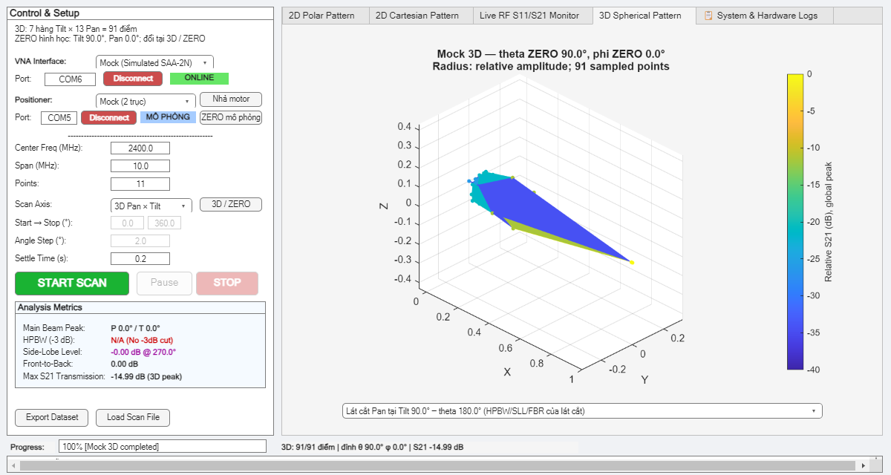
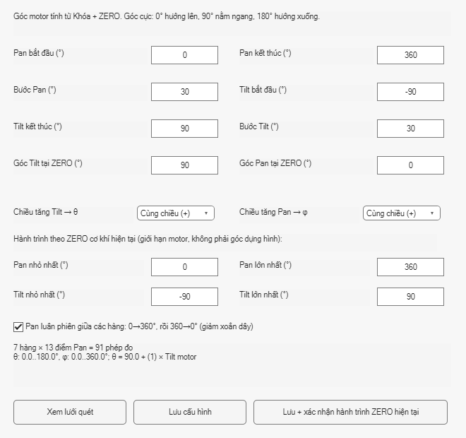

# Ver2: quét Pan × Tilt và pattern 3D

## Mở và chạy mô phỏng

Từ thư mục dự án trong MATLAB R2025b:

```matlab
addpath('matlab/classes','matlab/app');
app = AntennaMeasurementApp();
```

Giữ VNA và Positioner ở **Mock**, chọn **3D Pan × Tilt**, mở **3D / ZERO**.
Nhập Start, Stop, Step riêng cho hai trục. Mỗi hàng giữ Tilt tại một vị trí,
quét Pan, rồi chuyển sang hàng Tilt tiếp theo. Mặc định Pan đảo chiều giữa các
hàng để giảm việc quay hồi; bỏ tùy chọn này để mọi hàng quét cùng chiều.

## Khai báo hướng anten tại ZERO

ZERO cơ khí là vị trí đã căn bằng tay và bấm **Khóa + ZERO**. Góc hình học được
khai báo riêng trong cửa sổ cấu hình, không phát lệnh quay hoặc ZERO:

- `Tilt at ZERO` là theta tại ZERO: 0° hướng lên, 90° nằm ngang, 180° hướng xuống.
- `Pan at ZERO` là phi tại ZERO. Chiều tăng của mỗi trục chọn +1 hoặc −1.
- `theta = Tilt at ZERO + Tilt sign × góc motor Tilt`.
- `phi = Pan at ZERO + Pan sign × góc motor Pan`.

Ví dụ ZERO đặt anten nằm ngang: chọn theta ZERO = 90°, Tilt −90..90° và Pan
0..360° để bao phủ toàn cầu. Nếu ZERO đặt anten hướng lên: chọn theta ZERO = 0°,
Tilt 0..180°. Có thể chỉ quét một phần hoặc một hàng; theta phải trong 0..180°.
Start/Stop là góc motor tương đối với ZERO, không phải theta tuyệt đối.

Cấu hình lưu trong `prefdir/antenna-ver2-settings.mat` và tự tải khi mở app.
File cấu hình không xác nhận lại ZERO hay hành trình của thiết bị thật.

## Khi có thiết bị trở lại

1. Nạp firmware V4.0_HOLD trong `firmware/positioner_v3_hold` bằng PlatformIO,
   khi COM rảnh và cơ cấu an toàn để reset. Bản này đã build, chưa nạp/thử thật.
2. Chọn thiết bị thật, kết nối; **Nhả motor** → căn cả hai trục → **Khóa + ZERO**.
3. Trong **3D / ZERO**, khai báo hành trình cơ khí thực tế và bấm nút lưu kèm
   xác nhận hành trình cho ZERO hiện tại. Giới hạn số của firmware là Pan
   −360..360°, Tilt −180..180°; mỗi khoảng khai báo dài tối đa 360°. Khung và dây
   thực tế có thể có giới hạn nhỏ hơn. Sau mỗi lần nhả/ZERO/reset cần xác nhận lại.
4. Bắt đầu bằng một lưới nhỏ; kiểm tra cả hai encoder, chiều quay và góc bàn anten
   bằng dấu vật lý trước khi quét toàn cầu. Firmware cũ chỉ cho Tilt −5..95°;
   app kiểm tra giới hạn do firmware báo và từ chối lưới ngoài hành trình.

Chưa xác nhận hành trình thì lệnh hardware thường vẫn bị giới hạn Pan 0..360°,
Tilt −5..95°; quét 3D cần xác nhận rõ ràng. Cả hai AS5600 phải có dữ liệu hợp lệ.
Mất encoder, mất lực giữ hoặc mất ZERO sẽ dừng và giữ dữ liệu đã thu. Tilt với
dây cảm biến 2 m vẫn cần kiểm tra điện/phần cứng; cập nhật ver2 không xác nhận
đã sửa được liên kết này. Encoder đặt ở đuôi motor không đo độc lập góc bàn anten.

## Xem và lưu kết quả

Tab 3D dùng bán kính biên độ tương đối, màu S21 tương đối (dB), chuẩn hóa trên
toàn bộ lượt quét. Mỗi hàng Tilt có thể chọn để xem lát cắt 2D và chỉ số của lát
cắt đó. Đỉnh toàn lượt quét hiển thị riêng. Mock được ghi rõ trên hình và metadata.

STOP giữ điểm đã hoàn thành, hình và khả năng xuất file; quét lại được. Điểm
chưa đo để trống, không nội suy. Điểm Pan 0/360 và điểm ở cực được gộp trung bình
biên độ tuyến tính khi dựng hình; dữ liệu gốc giữ đủ các điểm.

**Export Dataset** lưu MAT (S11/S21 phức đầy đủ), CSV, JSON cấu hình/metadata,
TXT tóm tắt và ảnh. **Load Scan File** dùng hệ tọa độ trong file, dù cấu hình
hiện tại đã đổi. Dữ liệu 2D cũ vẫn đọc được; hình 3D dựng từ một lát 2D được ghi
rõ là mô hình ước lượng.

## Kiểm thử phần mềm

Các bài kiểm tra mới bao phủ quy đổi ZERO, lưới/chiều quét, giới hạn hành trình,
STOP lúc khởi tạo/chuyển hàng, Pause/Resume, mất encoder/ZERO, dữ liệu một điểm,
lưu/đọc cấu hình và export một hàng. Không chạy test hardware hay master runner
khi chưa có thiết bị. Xem lệnh chọn đúng suite trong `CODEX_GUIDE.md`.

Bản `ver1` được giữ nguyên để quay lại. Ver2 đang phát triển ở mã gốc của dự án
trên nhánh `codex/ver2-pan-tilt-3d`.

Kết quả kiểm tra phần mềm ngày 13/10/2026: **50/50 test MATLAB**, **39/39 test
Python** đạt; hai bộ test native cho giữ motor/lease và AS5600 đạt. PlatformIO
build thành công (RAM 21.592 byte, flash 302.701 byte). Mô phỏng hoàn thành 91/91
điểm. Chưa nạp firmware hoặc kiểm tra ESP32/VNA thật trong giai đoạn này.




