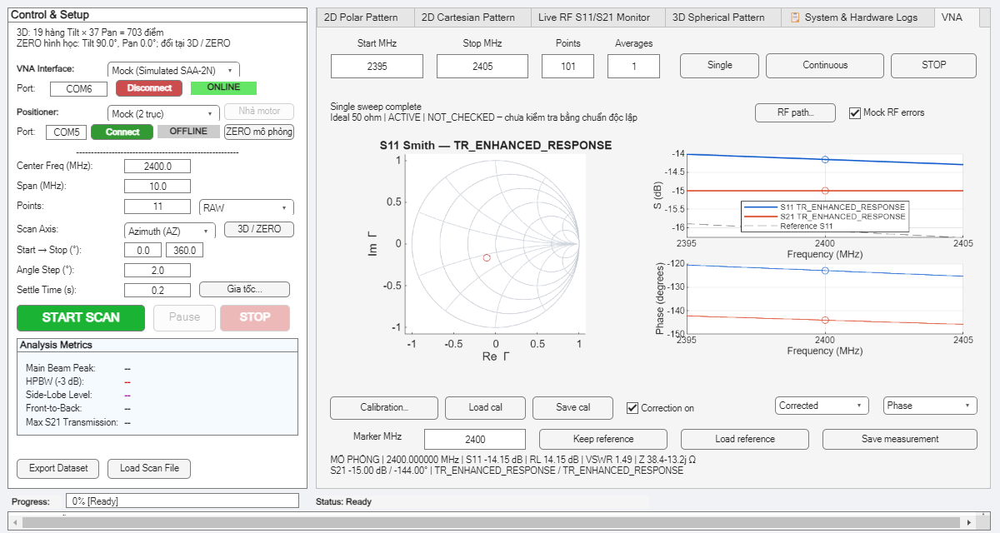
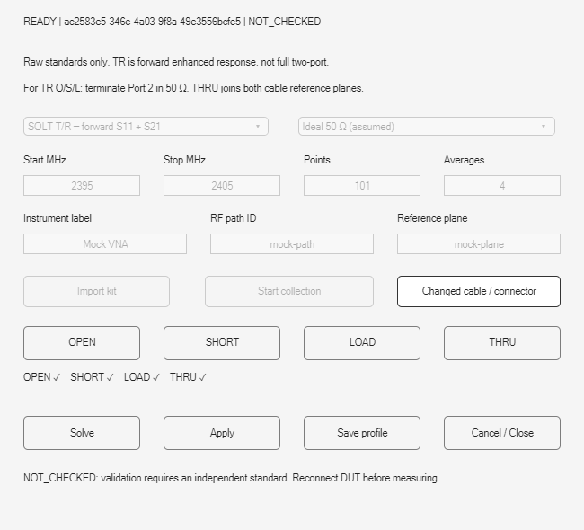

# VNA Workbench verification — 2026-10-15

Scope: software implementation of Tasks 1–14. Hardware qualification: **NOT_RUN**.
Baseline: `7ea2f9e55568c154f2689091c49566858dce3309`; no commit/push performed.

Final post-review run finished on 2026-10-16 (Asia/Bangkok): **68/68 Python tests; 97/97 MATLAB unit tests plus 3/3 Mock scripts; no VNA timer leaks**. Python test time4.214s; MATLAB log interval23:56:08–00:01:07 (about299s including startup/graphics/scripts).

## Reproduce safely

From the repository root in PowerShell:

```powershell
.\.venv-vna\Scripts\python.exe -X utf8 -m unittest discover -s python/tests -p 'test_*.py'
& 'C:\Program Files\MATLAB\R2025b\bin\matlab.exe' -batch "addpath('matlab/tests'); results=run_vna_software_tests();"
```

The MATLAB runner has an explicit software allowlist. It does not invoke the hardware master runner. Legacy Python tests use fake instruments and generate validation folders; preserve actual user measurements when tidying those outputs.

## Acceptance evidence

| Criterion | Evidence |
|---|---|
| A1 jobs/live/STOP/ownership | Python job concurrency, blocked configure/read cancellation, hardware guard; MATLAB controller/workbench/scan close tests |
| A2 independent SOL/TR | Independently generated three-term fixtures, characterized standards and actual MATLAB→Python calculation |
| A3 durable calibration | Fresh-process profile load, exact canonical JSON through MATLAB, MAT/profile roundtrip |
| A4 rejection and state | Grid/context/schema/hash/version/coefficients corruption; failed load preserves profile; unsolved draft cannot Apply |
| A5 analysis/plots | Smith/VSWR/impedance/phase, zero responses, marker tie selection, independent reference grid, reusable handles |
| A6 scans | RAW/SOL/TR 2D/3D; preflight before positioner, immutable profile snapshot, atomic partial rows, actual grid |
| A7 regressions | Explicit MATLAB software allowlist and three Mock scripts; Python fake-device suite; no leaked VNA timers |
| A8 persistence/views | Full complex CSV/MAT/S1P precision, Unicode, raw/corrected columns, legacy data provenance, 3D slices/RF monitor |
| A9 physical accuracy | **NOT_RUN** — [operator runbook](../../vna-workbench-hardware-qualification.md) |

Independent fixture maximum complex errors (not physical instrument uncertainty):

- SOL S11: `2.3263411494723067e-16`.
- TR S11: `2.68024601344063e-16`.
- TR S21: `1.1443916996305594e-16`.

## Final review

One independent review covered production sources and consumers. No Critical finding. Two Important findings and one Minor finding were reproduced with failing MATLAB tests, then fixed:

1. Async dispatch now only validates/caches on MATLAB; serial configuration runs exclusively inside the Python worker. A synchronous configuration trap tests the production dispatch method, and a blocked Python configuration test verifies poll/cancel remain responsive.
2. A dirty calibration draft blocks Apply and profile Save until Solve or explicit cancellation. Changing the display state to DISABLED cannot bypass that guard.
3. Controller replacement closes and clears the idle calibration dialog before the old controller is deleted.

The review did not qualify physical accuracy, real transport STOP deadlines, or unmeasured reverse channels.

## Visual inspection

Both screenshots were generated by `create_vna_workbench_mock_demo` and inspected. Standard capture indicators, correction provenance, Smith, magnitude, phase and marker readouts are visible at the default app size. Images show **Mock data**, not physical results.





## Environment and limits

MATLAB R2025b; Python 3.13.13; scikit-rf 2.1.0; NumPy 2.5.4; SciPy 1.18.1; pandas 3.0.6; pyserial 3.5, in `.venv-vna`.

MATLAB warns that Python 3.13 is unsupported. Executed bridge/calibration/persistence paths passed; this does not establish general supported interoperability. The warning is retained.

TR means forward enhanced response with the specified matched receive-port assumptions. It is not full two-port correction. No DUT S12/S22 or complete DUT S2P is fabricated. Calibration profiles start with independent validation status `NOT_CHECKED`.

Detailed local RED/GREEN logs: `.superpowers/sdd/2026-10-15-vna-workbench-plan/` (ignored scratch). Persistent workflow: [user guide](../../vna-workbench-user-guide.md), [implementation log](../../vna-workbench-implementation-log.md).
